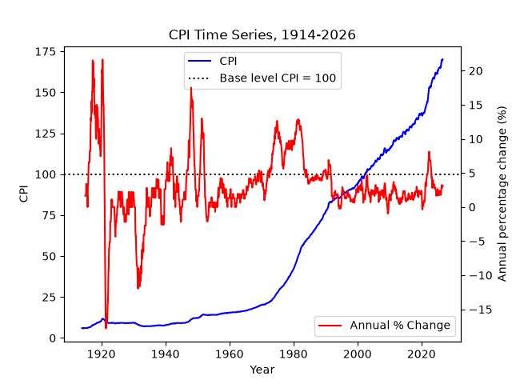

# FINE3300-2026-A2
Assignment 2

# Introduction
This python project replicates the Bank of Canada's inflation calculator using the monthly Consumer Price Index (CPI). It takes a dollar amount in the starting year and and ending year and returns the dollar amount in the ending year. It also returns CPI in both periods, an annualized inflation rate, a percent change and number of years. Our goal is to replicate this calculator and provide a graph that details a CPI time series. 

# Description of Files
First, I imported the CSV file that contained all of the CPI information from 1914-2016, and then read the file into a dataframe (skipping the first few rows of unnecessary information). I used min/max to define a date range for the user input.

1. The Graph
    I plotted a CPI time series as well as annual percentage change over the years. I used basic matplotlib functions to define 3 axes, one for CPI, one for annual percentage change and one for years. I also added a legend and colour formatting for readability. There is a dotted line that represents a base CPI level of 100. 

2. The calculator
    This calculator differs because I used monthly precision instead of yearly. I have the user input a dollar amount and two time periods with MM/YYYY formatting. I have various safeguards using loops to protect against wrong inputs from the user. These include dates that fall out of the range, data type mismatches, etc.
    
    One of my major assumptions is to keep the inflation rate as an annnual rate instead of a monthly one, as this is standard convention in the industry. The years are formatted in decimals for the final output.
    
    The code prompts user input and locates the CPI for the given dates in the data frame. It then performs the necessary calculations (rate of inflation, percent change, etc.) and prints the output similar to that of the BoC calculator.  

# Other Notes
This code, unlike Assignment 1, does not assume perfect inputs from the user, which is why a bulk of the calculator code contains protection against bad inputs. The prices are all assumed to be in Canadian dollars. 

# The Graph

The CPI time series is about what I would expect, with a gradual increase over the years and steeper inflation in recent years. Huge annual percent changes in the early twenties are most likely explained by the rapid economic expansion and depression in the years following WW1. I also noticed that annual change has tended to smooth out throughout the years, perhaps indicating structural changes in the economy or a different emphasis on central banking.

# Sample Output

Enter a starting dollar amount: 100
Enter the first date (MM/YYYY): 05/2000
Enter the second date (MM/YYYY): 08/2020
- $100.00 CAD in 05/2000 is worth $144.36 CAD in 08/2020
- Percent Change: 44.36%
- Number of years: 20.25
- Average annual rate of inflation (decline in TVM) was 1.83%
- CPI for first date: 94.90 (05/2000)
- CPI for second date: 137.00 (08/2020)